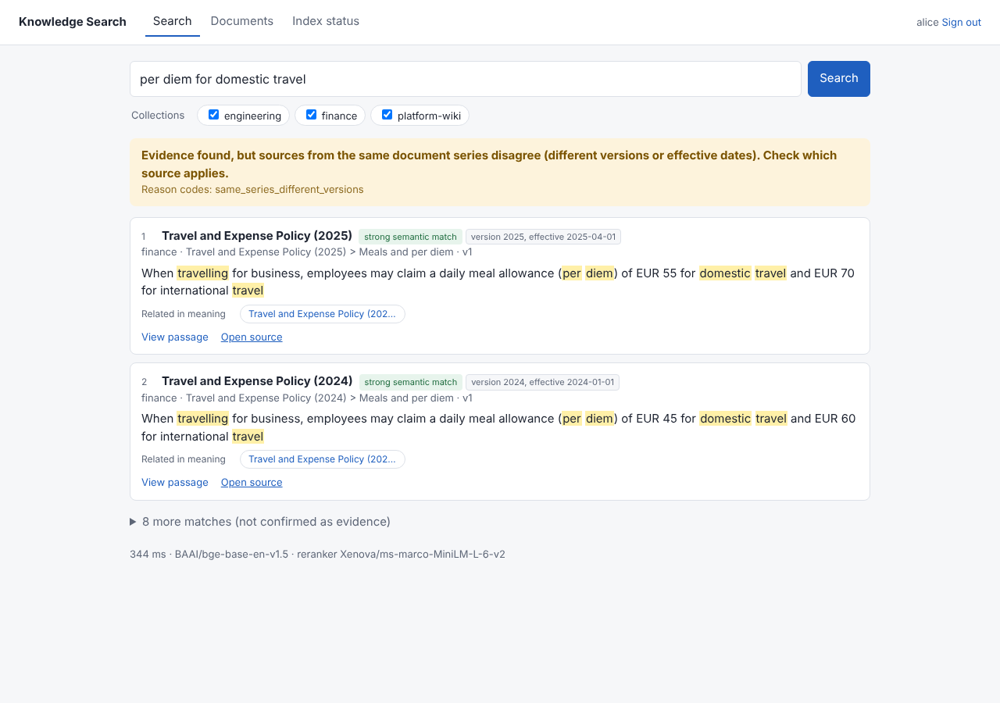

# Knowledge Search

**Private, offline document search that shows its evidence — and says so when it has none.**

Knowledge Search indexes your PDF, Word, PowerPoint, HTML, Markdown and text documents and lets people search
them in plain language or by exact terms (error codes, file names, API paths). Every result is a real
passage from your documents, with a link to the original file. Everything — database, search models,
search — runs on your own machine or server: no cloud account, no GPU and no external AI provider are
needed. An optional small language model, also local, writes a short summary and topics for each document.



## Features

- **Hybrid search** — keyword + semantic (local embedding model) + exact-identifier matching, fused by rank.
- **Offline reranker** (on by default) — a local cross-encoder re-orders the top results for higher precision.
- **Evidence-first answers** — each search states whether adequate evidence was found, sources conflict,
  the index is incomplete, or nothing adequate exists in the sources *you* can access. No invented
  confidence numbers.
- **Traceable results** — passage, heading/page, neighbouring context and a link to the original file.
- **Connections** — links between documents (Markdown/wiki links, HTML links, `depends_on`-style front matter) with a
  "what depends on this" blast-radius view, permission-filtered.
- **Related documents with every result** — what the page links to, what refers to it, what it mentions and
  what is related in meaning, as one-click rows under each result; results cover 10 different documents.
- **Optional document summaries** — a small local language model writes a two-sentence summary, topics and,
  for vaguely titled pages, a clearer title, in the background while indexing is idle. Labelled as written by
  the model; never used as evidence.
- **Link-aware search** — questions that name a page also get passages from the pages it links to and from
  ("who owns the services X depends on"); on a labelled synthetic wiki, multi-hop evidence recall 0.24 → 0.60
  with no single-hop loss ([evaluation](docs/evaluation.md#6-link-aware-search-graph-assisted-retrieval)).
- **Permissions** — collections with group-based read/write access, enforced inside every query.
- **Admin UI** — upload by drag and drop, change models/chunking/reranking, manage users and access, reindex.
- **One-click install** — embedded PostgreSQL + pgvector; nothing else to install.

## What runs on your machine

| Part | What it does | Size |
|---|---|---|
| Embedded PostgreSQL + pgvector | stores documents, passages, links and access rights | installed by setup |
| Embedding model (bge-base-en-v1.5) | turns each passage and each question into numbers, so a search finds passages with the same *meaning*, not only the same words | ~210 MB |
| Reranker (ms-marco-MiniLM-L-6-v2) | re-orders the top 10 results by how well each passage matches the question | ~90 MB |
| *Optional:* language model (Gemma 4 E2B, run by llama.cpp) | writes a summary, topics and (for vague titles) a clearer title per document, in the background | ~3.2 GB |

The models run on any CPU and are downloaded once by setup. **Search never depends on the language model:**
every result is a passage that is really in your documents; the summaries only help you read the results
(and, with "Add a line about the whole document to every passage" on, help find passages that never name
their subject). It works
one document at a time, only while no files are waiting to be indexed, so new files become searchable first:
about 8–13 seconds per document on the 4-core test machine, so ~128 documents take roughly 20–30 minutes
after indexing. Nothing is sent anywhere. Writing answers and reading images with local models were tested
too ([the plan](docs/plan-images-and-models.md)) and are not part of this release.

## Quick start

**Windows 10/11** — open *Command Prompt* (or PowerShell) and run:

```bat
git clone https://github.com/MayankPunghal/knowledge-search
cd knowledge-search
setup.bat --demo
```

(No git? Download the ZIP from GitHub, extract it and double-click `setup.bat` — it asks whether to load the
sample documents.)

**macOS / Linux:**

```bash
git clone https://github.com/MayankPunghal/knowledge-search
cd knowledge-search
./setup.sh --demo
```

| Option (both scripts) | Effect |
|---|---|
| `--demo` | load the fictional sample documents and demo users without asking |
| `--no-demo` | skip the sample data |
| `--no-start` | install only; do not start the app afterwards |
| `--no-shortcut` | Windows only: do not create the desktop shortcut |
| `--summaries` / `--no-summaries` | download the summary model during setup / turn summaries off, without asking (~3.2 GB; otherwise the app downloads it in the background on first start) |

Setup installs everything for the current user (no administrator rights, no Docker): uv, Python 3.13, the
app, an embedded PostgreSQL and the offline AI models (~900 MB in total, one time). It is safe to re-run —
if the internet connection drops during a download, run it again and completed files are reused. At the end
it opens <http://127.0.0.1:8000>, where you create the administrator account.

Start the app later with the **Knowledge Search** desktop shortcut or `start.bat` (Windows), or `./start.sh`
(macOS/Linux). Full walkthrough and a test run with your own documents:
**[Getting started](docs/getting-started.md)**.

## Search a website or intranet

1. **Copy the site** with **site2md** (in [`site2md/`](site2md/README.md); zip that folder to share it):
   double-click `Crawl Website.bat` (Windows) or `Crawl Website.command` (macOS), paste the address, give the
   copy a name and sign in in the browser window if the site asks. You get `site2md/output/<name>/`: one
   Markdown file per page, plus the PDF, Word and PowerPoint files the pages link to or embed (Google Drive
   files and folders included), as they are.
2. **Index the copy:** sign in to Knowledge Search as the administrator → **Users & access** → create a
   collection (e.g. `intranet`) and grant it to the people who should see it → **Documents** → choose
   that collection → **choose a folder** → select `output/<name>`. Every page and file is uploaded; the rest
   (`manifest.json`) is skipped.
3. **Search.** Each page keeps its web address ("Original: https://…" in the passage view) and is linked to
   the documents it attaches, so the page and its PDFs are found together and connected under
   **Connections**.

Command-line alternative for step 2: `uv run knowledge-search ingest intranet site2md/output/<name> --wait`.

## Documentation

| Guide | For |
|---|---|
| [Getting started](docs/getting-started.md) | Installing, first run, trying it with sample or your own documents |
| [How it works](docs/how-it-works.md) | Plain-language explanation: embeddings, search, links, evidence check, why one database |
| [User guide](docs/user-guide.md) | Searching, reading results and outcomes, uploading documents, answering with Claude through the optional skill |
| [Admin guide](docs/admin-guide.md) | Settings (models, chunking, reranker, evidence thresholds), users and access, reindexing |
| [Configuration](docs/configuration.md) | All `KS_*` environment variables |
| [Deployment](docs/deployment.md) | Laptop vs. dedicated server, Docker/external PostgreSQL, TLS, backups, GPU notes |
| [Development](docs/development.md) | Project layout, running tests, evaluation scripts, API |
| [Evaluation](docs/evaluation.md) | Measured retrieval quality, abstention, latency — and their limits |
| [Architecture](docs/architecture.md) | Design, decisions and alternatives considered, sources |
| [Research: better search](docs/research-search.md) · [graph](docs/research-graph.md) | Techniques evaluated or planned, with sources |
| [Troubleshooting](docs/troubleshooting.md) | Common problems and fixes |
| [Handoff](docs/HANDOFF.md) | Project status, verified vs. unverified items, next steps |

## Requirements

64-bit Windows 10/11, macOS or Linux; 4 GB free RAM (8 GB recommended for the larger models); ~2 GB disk;
(+3.2 GB disk and ~4 GB RAM with the optional summary model); internet access during setup only (to download the app's
dependencies and models). Nothing needs to be
installed beforehand. After setup it runs offline.

**Speed:** search answers in under a second. Indexing is limited by the embedding model on the CPU: on the
4-core test machine about 5–7 passages per second (a 10-page PDF has ~30 passages; 623 Kubernetes
docs pages took 28 minutes), and faster on a modern
laptop. It runs in the background; documents become searchable one by one. Scanned PDFs without a text
layer and text inside images are not indexed (no OCR).

## Status

Version 1.0: search with cited passages, related documents and optional document summaries (no generated
answers, no OCR). See [Handoff](docs/HANDOFF.md) for exactly what
has been verified and what has not.

## License

No license has been chosen yet; all rights reserved by the repository owner. Third-party components and
models are under their own licences (listed in [Architecture](docs/architecture.md#licences)).
