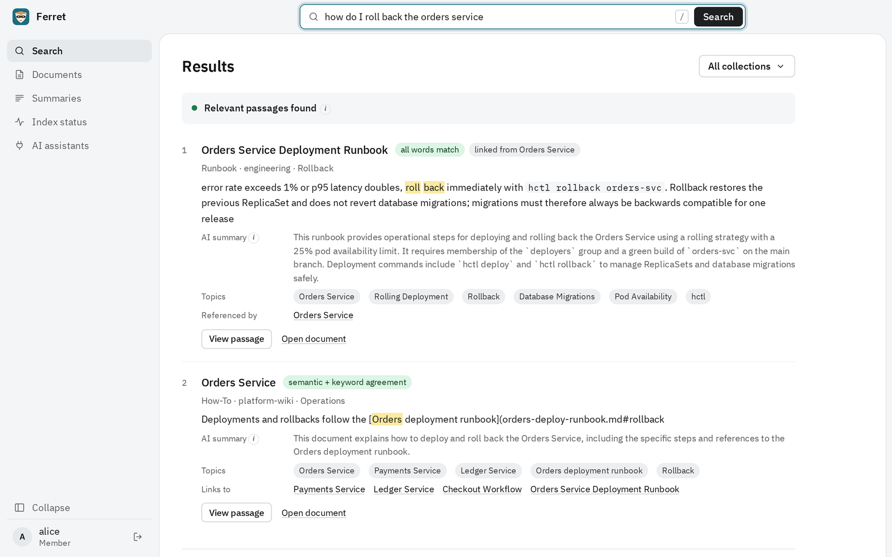
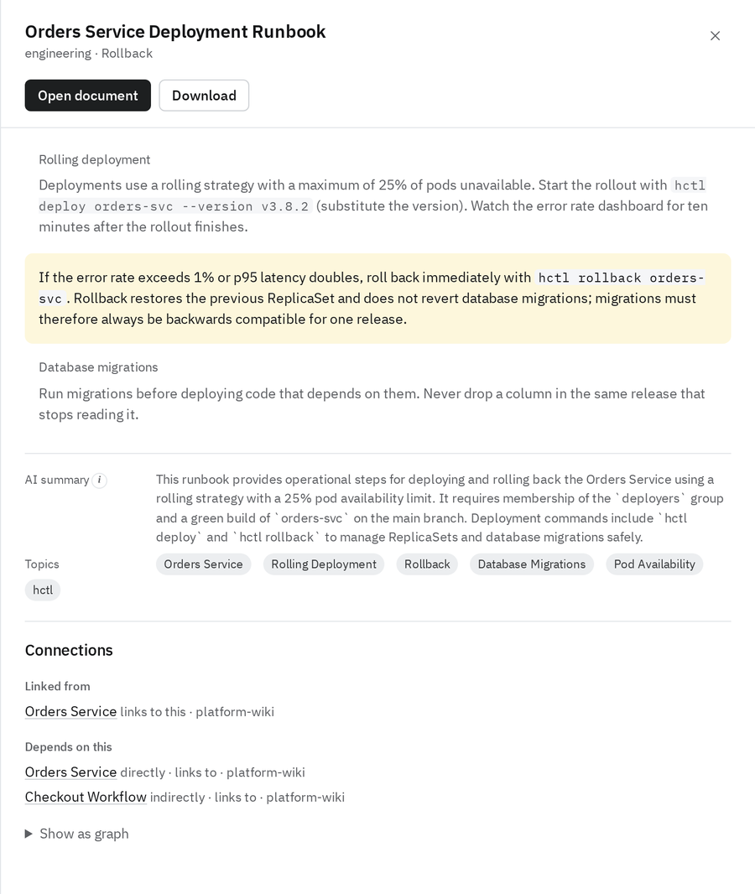
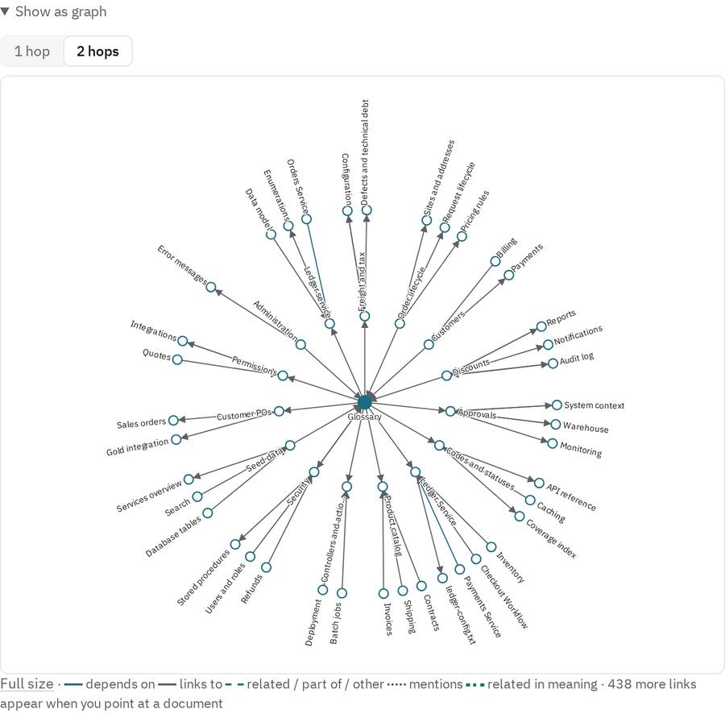

<p align="center">
  
</p>

<h1 align="center">Ferret</h1>

<p align="center">
  <strong>Private search for your team's documents. Every answer cites the passage it came from,<br>
  and when nothing supports it, Ferret says so.</strong>
</p>

<p align="center">
  
  
  
  
  
</p>

<p align="center">
  <a href="#quick-start">Quick start</a> ·
  <a href="#what-it-does">What it does</a> ·
  <a href="#copy-a-website-with-ferret-crawler">Ferret Crawler</a> ·
  <a href="#connect-an-ai-assistant">AI assistants</a> ·
  <a href="#documentation">Docs</a>
</p>

<picture>
  <source media="(prefers-color-scheme: dark)" srcset="docs/screenshots/ferret-search-dark.png">
  
</picture>

## Quick start

**Windows 10/11**: open *Command Prompt* and run

```bat
git clone https://github.com/MayankPunghal/ferret
cd ferret
setup.bat --demo
```

**macOS / Linux**

```bash
git clone https://github.com/MayankPunghal/ferret
cd ferret
./setup.sh --demo
```

Setup takes a few minutes. It installs everything for your user account (no admin rights, no Docker),
then opens **<http://127.0.0.1:8000>**, where you create the administrator account. `--demo` loads fictional
sample documents to try it on.

No git? **Code → Download ZIP**, unzip, double-click `setup.bat`. Next time, start Ferret from the desktop
shortcut, `start.bat` or `./start.sh`.

<details>
<summary><b>Setup options</b></summary>

| Option | Effect |
|---|---|
| `--demo` / `--no-demo` | load the sample documents and demo users, or skip them, without asking |
| `--summaries` / `--no-summaries` | download the optional summary model now (~3.2 GB), or turn summaries off |
| `--no-start` | install only |
| `--no-shortcut` | Windows: no desktop shortcut |

Re-running setup is safe: finished downloads are reused. Full walkthrough: [Getting started](docs/getting-started.md).
</details>

## What it does

- 🔎 **One box, two kinds of search** — Exact terms (`ERR-PAY-4012`, `/api/v2/invoices`, a file name) and plain questions ("how do I roll back a release?"), together.
- 📎 **Evidence, not guesses** — Every result is a real passage with a link to the file and page. If nothing in *your* documents supports an answer, Ferret says so.
- 🔒 **Stays on your machine** — Database, models and search all run locally. No account, no GPU, no API keys.
- 🕸️ **Follows your links** — Wiki links, Markdown links and `depends_on` front matter: see what a page links to, what refers to it, and what breaks if it changes.
- 🕷️ **Ferret Crawler** — Copies a website or intranet, even one behind a sign-in, into a collection.
- 🤖 **Works with your AI assistant** — A built-in MCP server lets Claude, Cursor or VS Code search your documents. Tokens are read-only unless you allow changes.
- 👥 **Teams and permissions** — Collections, groups and read/write access, enforced inside every query.
- 📝 **Optional summaries** — A small local model writes a summary, a type and topics for each document, in the background. These are labelled and never used as evidence.

Reads **PDF, Word, PowerPoint, HTML, Markdown and text**. Scanned PDFs without a text layer and text inside
images are not read yet (no OCR).

<table>
  <tr>
    <td width="50%" valign="top"></td>
    <td width="50%" valign="top"></td>
  </tr>
  <tr>
    <td align="center"><sub>The passage in context, with its document's summary and connections</sub></td>
    <td align="center"><sub>Two hops of links around a page; point at one to see all its links</sub></td>
  </tr>
</table>

## Copy a website with Ferret Crawler

1. Sign in as administrator → **Crawler** → **Copy a website**. Paste the address. If the site asks you to
   sign in, a browser window opens; sign in there.
2. When the copy finishes, **Add to a collection** (an existing one or a new one). Its pages and the PDF, Word and
   PowerPoint files they link to are indexed, each page keeping its web address.
3. **Update** later brings in only what changed.

Ferret Crawler also runs on its own (double-click `site2md/Crawl Website.bat` or `.command`); see
[its README](site2md/README.md).

## Connect an AI assistant

Create a token under **AI assistants**, then, for Claude Code:

```bash
claude mcp add --transport http ferret http://127.0.0.1:8000/mcp --header "Authorization: Bearer <your token>"
```

The page has ready-to-copy setups for Claude Desktop, Cursor and VS Code. Passages the assistant reads go
to its provider, so check your policy before connecting confidential collections.
[More](docs/user-guide.md#connecting-an-ai-assistant-mcp-optional-sends-passages-to-the-assistants-provider).

## What runs on your computer

| Part | Size | Job |
|---|---|---|
| PostgreSQL + pgvector (embedded) | installed by setup | stores documents, passages, links and access rights |
| bge-base-en-v1.5 | ~210 MB | finds passages by meaning |
| jina-reranker-v1-turbo-en | ~150 MB | re-reads the top results and judges evidence |
| *Optional:* Gemma 4 E2B or a smaller model (llama.cpp) | 0.5–3.2 GB | summaries, types and topics, in the background |

**Needs:** 64-bit Windows 10/11, macOS or Linux; 4 GB free RAM (8 GB recommended); ~2 GB disk. Internet only
during setup. **Speed:** a search usually answers in under a second on a CPU. Indexing runs in the background:
about 5–7 passages per second on a 4-core test machine, so a 10-page PDF takes ~5 s. Measurements and their limits:
[Evaluation](docs/evaluation.md).

## Documentation

| Guide | For |
|---|---|
| [Getting started](docs/getting-started.md) | install, first run, try it on your own documents |
| [User guide](docs/user-guide.md) | searching, reading results, uploading, AI assistants |
| [Admin guide](docs/admin-guide.md) | settings, users and groups, synced folders, the crawler, reindexing |
| [How it works](docs/how-it-works.md) | plain-language tour: embeddings, evidence check, links |
| [Deployment](docs/deployment.md) · [Configuration](docs/configuration.md) | server setups, Docker, TLS, backups, `KS_*` variables |
| [Evaluation](docs/evaluation.md) | measured retrieval quality, abstention and speed |
| [Architecture](docs/architecture.md) · [Development](docs/development.md) | design decisions, project layout, tests, API |
| [Troubleshooting](docs/troubleshooting.md) | common problems and fixes |
| [Handoff](docs/HANDOFF.md) · [To do](docs/TODO.md) · [Plans](docs/PLANS.md) | project status: verified vs. not yet verified; open work |

## Status and license

Version 1.0: cited search, connections, optional summaries, crawler and MCP server. Ferret does not
write generated answers yet. [Handoff](docs/HANDOFF.md) lists exactly what has been verified.

No license has been chosen yet; all rights reserved by the repository owner. Third-party components and
models keep their own licences ([list](docs/architecture.md#licences)).
