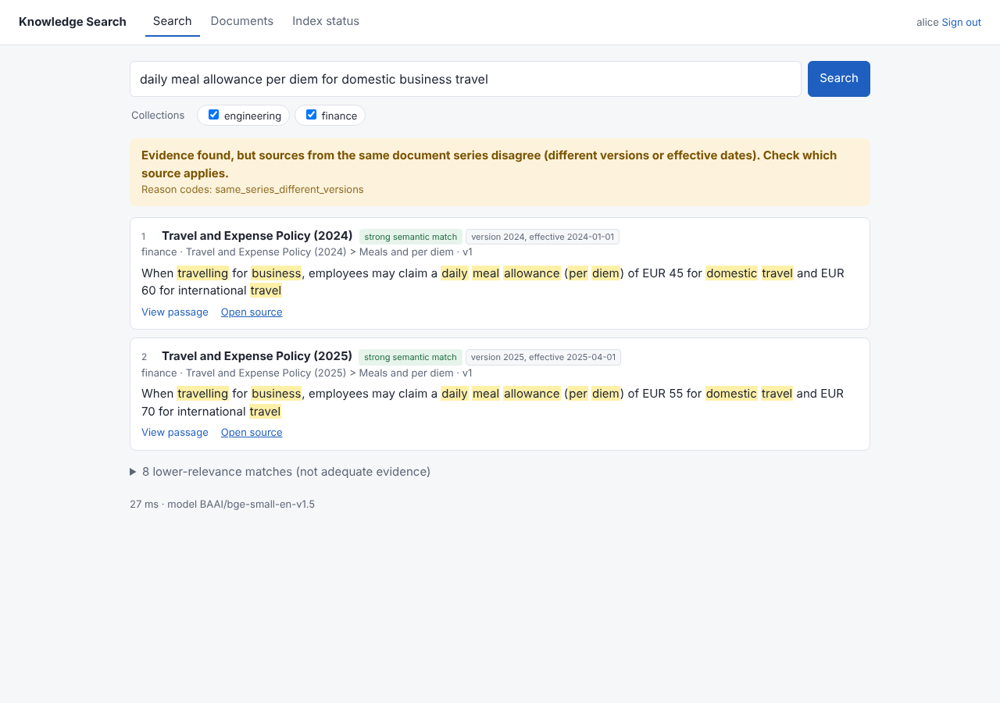

# Knowledge Search

**Private, offline document search that shows its evidence — and says so when it has none.**

Knowledge Search indexes your Markdown, text and PDF documents and lets people search them in plain
language or by exact terms (error codes, file names, API paths). Every answer points to the exact passage
and the original file. Everything — database, AI models, search — runs on your own machine or server:
no cloud account, no GPU and no external AI provider are needed.

## Features

- **Hybrid search** — keyword + semantic (local embedding model) + exact-identifier matching, fused by rank.
- **Offline reranker** (optional) — a local cross-encoder re-orders the top results for higher precision.
- **Evidence-first answers** — each search states whether adequate evidence was found, sources conflict,
  the index is incomplete, or nothing adequate exists in the sources *you* can access. No invented
  confidence numbers.
- **Traceable results** — passage, heading/page, neighbouring context and a link to the original file.
- **Permissions** — collections with group-based read/write access, enforced inside every query.
- **Admin UI** — upload by drag and drop, change models/chunking/reranking, manage users and access, reindex.
- **One-click install** — embedded PostgreSQL + pgvector; nothing else to install.

## Quick start

| Platform | Do this |
|---|---|
| **Windows 10/11** | Download or clone this repository, then double-click **`setup.bat`** |
| **macOS / Linux** | `./setup.sh` |

The setup installs everything it needs for the current user (no administrator rights), offers to load
fictional sample documents, and opens <http://127.0.0.1:8000>, where you create the administrator account.
Later, start the app with the **Knowledge Search** desktop shortcut, `start.bat`, or `./start.sh`.

Full walkthrough, including a test run with a few documents: **[Getting started](docs/getting-started.md)**.

## Documentation

| Guide | For |
|---|---|
| [Getting started](docs/getting-started.md) | Installing, first run, trying it with sample or your own documents |
| [User guide](docs/user-guide.md) | Searching, reading results and outcomes, uploading documents |
| [Admin guide](docs/admin-guide.md) | Settings (models, chunking, reranker, evidence thresholds), users and access, reindexing |
| [Configuration](docs/configuration.md) | All `KS_*` environment variables |
| [Deployment](docs/deployment.md) | Laptop vs. dedicated server, Docker/external PostgreSQL, TLS, backups, GPU notes |
| [Development](docs/development.md) | Project layout, running tests, evaluation scripts, API |
| [Evaluation](docs/evaluation.md) | Measured retrieval quality, abstention, latency — and their limits |
| [Architecture](docs/architecture.md) | Design, decisions and alternatives considered, sources |
| [Troubleshooting](docs/troubleshooting.md) | Common problems and fixes |
| [Handoff](docs/HANDOFF.md) | Project status, verified vs. unverified items, next steps |

## Requirements

64-bit Windows 10/11, macOS or Linux; 4 GB free RAM (8 GB recommended for the larger models); ~2 GB disk;
internet access during setup only (to download the app's dependencies and models). After setup it runs
offline.

## Status

First release: retrieval-only (no generated answers). See [Handoff](docs/HANDOFF.md) for exactly what has
been verified and what has not.

## License

No license has been chosen yet; all rights reserved by the repository owner. Third-party components and
models are under their own licences (listed in [Architecture](docs/architecture.md#licences)).
